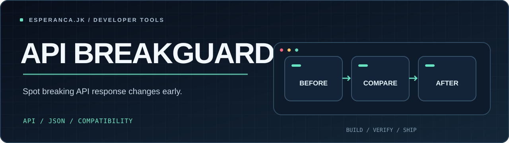

<p align="center"></p>

# api-breakguard

Spot **potential** breaking changes between two JSON API response snapshots. A minimal Node.js CLI with zero runtime dependencies.

## Example

```bash
git clone https://github.com/Esperanca-jk/api-breakguard.git
cd api-breakguard
node src/cli.js examples/before.json examples/after.json
node src/cli.js examples/before.json examples/after.json --json
npm test
```

The example detects a removed `user.role` field and a numeric-to-string change in `user.id`.

## What it reports

| Finding | Severity |
| --- | --- |
| Field removed | Breaking |
| JSON type changed | Breaking |
| Field added | Info |
| Empty array on either side | Inconclusive info |

**Exit codes:** 0 = no observed breaking changes; 1 = potential breaking change; 2 = invalid input.

## Scope and limitations

This tool compares **example responses**, not OpenAPI or JSON Schema contracts. Arrays are checked using their first element only; heterogeneous arrays, optional fields, nullable variants, and changes not represented by the snapshots may be missed or misclassified. It does not infer endpoint semantics. Use it as an inexpensive smoke test, not as a compatibility guarantee.

It does not send data to third parties and does not need network access.

## Contributing

`npm test` uses Node's built-in test runner. Contributions that improve inference should add regression fixtures. See [CONTRIBUTING.md](CONTRIBUTING.md).

[MIT License](LICENSE).


---

**Related tool:** [env-contract](https://github.com/Esperanca-jk/env-contract) — catch configuration drift before deployment.
